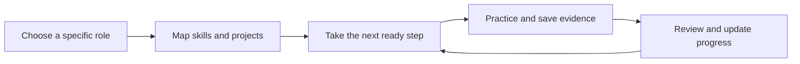

<div align="center">

<h1>Code2Career Pathfinder</h1>

<p><strong>Know where you want to go. Know what to do next.</strong></p>

<p>Turn a specific career ambition into connected skills,<br>practical projects, and a manageable next step.</p>

<p><strong>Primary track:</strong> Statement 1, Reverse-Engineered Career Roadmapper<br><strong>Current stage:</strong> Deployed demo; browser and institutional acceptance in progress</p>

</div>

---

## Try Pathfinder

| Live workspace | URL |
| --- | --- |
| **Learner** | [code2career-pathfinder.vercel.app/app](https://code2career-pathfinder.vercel.app/app) |
| **Teacher / organization** | [code2career-organization.vercel.app/org](https://code2career-organization.vercel.app/org) |
| **Platform operator** | [code2career-admin.vercel.app/admin](https://code2career-admin.vercel.app/admin) |

New sign-ups default to learners. Teacher access requires operator assignment.

### Evaluation accounts

| Surface | Hosted sign-in email | Access |
| --- | --- | --- |
| **Admin** | `yash113gadia@gmail.com` | Platform flags, account/organization management, usage counts and redacted audit events at `/admin`. Fresh sign-in still requires resolution of the existing password-reset issue. |
| **User** | `pathfinder.learner-a+clerk_test@example.com` | Saved roadmaps, milestone guidance, progress, evidence and preparation at `/app`. |
| **Organization** | `pathfinder.teacher+clerk_test@example.com` | Assigned learners, assignments, evidence reviews and classroom quizzes at `/org`. This account has the teacher role. |

Hosted passwords are supplied privately, never committed. For a local workspace checkout, the team can find the credential handoff in the ignored `.data/evaluator-access.md`. An evaluator with repository access only can use all three local accounts below; hosted passwords and API keys are not needed for local manual planning, role checks or repository-authored diagnostic/classroom questions. New AI generation requires a separately supplied server-side key and remaining quota.

| Local surface | Username | Password after seeding | Entry point |
| --- | --- | --- | --- |
| **Admin** | `admin` | Your `DEV_ACCOUNT_PASSWORD` | `http://127.0.0.1:3300/admin` |
| **User** | `learner` | Your `DEV_ACCOUNT_PASSWORD` | `http://127.0.0.1:3300/app` |
| **Organization** | `teacher` | Your `DEV_ACCOUNT_PASSWORD` | `http://127.0.0.1:3300/org` |

Follow [Run locally](#run-locally), then run `npm run seed:dev`. These accounts exist only in explicit local development mode. The seeded teacher and learner share an organization; the admin role cannot read private learner roadmaps. Seeding creates accounts and memberships, not invented learner activity or AI results.

For evaluation, start with the learner's saved roadmap or create a manual plan, read a phase and a milestone, and try the built-in diagnostic. Use the organization account to review assigned learners and prepare a classroom quiz. Use the admin account to inspect service controls and the directory. Separate browser profiles avoid replacing another role's sign-in. On the live app, inspect saved work before spending the remaining generation allowance. [Progress](progress.md) records measured checks and unfinished acceptance; browser/mobile review and fresh hosted admin login remain pending.

### When AI is rate limited

There are two independent limits:

- **OpenRouter allowance:** Free model variants share an account-level request allowance. OpenRouter documents 20 requests per minute and 50 per UTC day before qualifying credit purchases; purchasing at least $10 in credits raises the daily ceiling to 1,000. Check `GET https://openrouter.ai/api/v1/key` from a trusted server or the provider dashboard for `free_model_daily_requests`. Its credit `limit_remaining` is a spending limit, not a count of free requests. Honor `Retry-After` or the rate-limit reset returned on a rejected request. Extra API keys do not reset the account allowance, and switching free models does not replenish a depleted daily allowance. See [OpenRouter's official limits](https://openrouter.ai/docs/api_reference/limits).
- **Pathfinder allowance:** `/api/me` reports `aiQuota.used`, `limit` and `resetsAt`. The hosted configuration allows 20 generation requests per user in a rolling 24-hour window. Generation failures and the single permitted roadmap repair also consume allowance. Buying OpenRouter credits does not raise this application limit; `AI_DAILY_LIMIT` is a separate server setting capped at 30.

Saved roadmaps, cached milestone guidance, submitted results, manual planning and the built-in diagnostic remain usable without new AI calls. Multiple-choice retakes of an existing personal quiz do not require AI. Generating a new quiz or grading written answers does. Avoid repeated generation clicks while a provider is rejecting requests.

For a larger provider allowance, the team can top up OpenRouter and keep the selected `:free` model, or explicitly configure a funded paid model with a spending cap. Neither option is enabled automatically. OpenRouter takes precedence over the optional CodeCraft/Gateway settings while `OPENROUTER_API_KEY` is set; there is no automatic provider failover. The last hosted CodeCraft check returned 403, so it is not a verified fallback. Provider and upstream capacity limits can still apply after a top-up.

[Why we exist](#why-we-exist) · [Who we serve](#who-we-serve) · [The experience](#the-experience) · [Progress](#done-left-and-the-next-16-hours) · [Architecture](#architecture-and-why) · [Run locally](#run-locally)

## Personal practice quizzes

The learner home includes upcoming milestones, progress and personal practice. Open [My practice quizzes](https://code2career-pathfinder.vercel.app/app/quizzes) after signing in. For local development, run `npm run dev` and open http://127.0.0.1:3300/app.

Learners can generate quizzes from a whole roadmap, a phase or a milestone, or choose quantitative, logical and verbal reasoning. Choose 5 or 10 questions, difficulty, multiple-choice or written answers, and optional timing. Drafts and attempts are saved; results include topic scores, explanations, rubric feedback, retakes, weak-topic practice and mistake-notebook notes. AI-generated material is disclosed and can be flagged. Quiz scores do not complete roadmap milestones or certify readiness.

## Roadmap reading

Use the View menu to read one phase with its prerequisites, or open the full roadmap. A line grid, compact branches, phase colours and larger milestone labels help track the arrows. Focus selected brings the current milestone closer; the milestone list and full SVG export remain available. Progress and dependency rules come from the saved roadmap.

## Why we exist

Choosing a career does not tell a student which skills to learn first, what to build, or how to fit the work around college and other commitments. Courses, practice tools, and career advice often leave the learner to assemble that path themselves.

**Pathfinder exists to close the gap between a career goal and the next useful action.** We work backward from a specific role, connect its prerequisites, and give each milestone a concrete deliverable and an effort estimate.

Our goal is to help learners make steady, visible progress toward their chosen career, with plans they can adapt and work that mentors can review. The longer-term aim is an institutional platform connecting planning, preparation, and evidence of learning.

## Who we serve

| Audience | What they need | Why they return |
| --- | --- | --- |
| **Students and early-career learners** | A practical path toward a job or internship | Next tasks, saved progress, milestone guidance, and practice history |
| **Teachers and mentors** | A way to guide learners beyond generic advice | Assignments, submitted work, and feedback within their assigned scope |
| **Colleges, placement cells, and training organizations** | Connected preparation across a cohort | Classroom quizzes, reviews, and organization reports |
| **Platform operators** | Controlled access and dependable operations | Membership management, feature controls, usage, and redacted audit events |

Learners use `/app`, organization staff use `/org`, and operators use `/admin`. Staff access is checked on the server; an operator's role does not grant access to private learner roadmaps.

## The experience

Pathfinder turns an exact career goal into an AI-generated dependency graph of skills, projects, intermediate roles, and the target role. Learners explore milestones, request actionable guidance, and record prior knowledge or completed work; those marks update the remaining effort and available next steps.



| Step | What happens |
| --- | --- |
| **Set your destination** | Describe the role, starting knowledge, weekly availability, horizon, and budget. |
| **Understand the route** | Explore phases, prerequisites, deliverables, and workload estimates in an interactive graph or companion list. |
| **Act on a milestone** | Request specific actions, a project brief, acceptance criteria, and assessment questions. |
| **Make progress visible** | Record learning, submit evidence, and receive teacher feedback where assigned. |
| **Keep preparing** | Use diagnostics, an error notebook, classroom quizzes, and AI discussion practice alongside the roadmap. |

Workload estimates share weekly hours across all remaining work. Self-reported completion, practice scores, and teacher-reviewed evidence remain distinct.

## What we added beyond the brief

The roadmap remains the core of **Statement 1**. Preparation draws from **Statement 3, AptiQuiz**, and **Statement 2, GD Arena**.

- **A daily next step:** Today's work turns available milestones into manageable tasks.
- **Plans that can change:** Editable milestones, time-budget updates, immutable revisions, conflict detection, and restore protect saved work.
- **Evidence and mentoring:** Private submissions, assignments, and scoped reviews connect planning to work learners actually produce.
- **Practice with memory:** Diagnostics, attempt history, and an error notebook turn mistakes into revision tasks.
- **Classroom preparation:** Reusable question sets, timed rooms, shuffled options, leaderboards, topic reports, and organization leagues support cohorts.
- **Discussion coaching:** Saved AI-panel discussions and feedback tied to exact learner quotes support reflection. Optional browser speech still needs acceptance testing.
- **Sharing by choice:** Data/SVG exports and revocable roadmap snapshots exclude private progress and evidence.

## Done, left, and the next 16 hours

**Recorded evidence as of 10 October 2026.** Implementation, backend verification, and browser acceptance are separate milestones. Detailed results live in [progress.md](progress.md).

| Area | Recorded verification | Still to verify or finish |
| --- | --- | --- |
| **Career roadmap** | Two distinct hosted AI goals produced validated, saved graphs; guidance and a known-skill effort update passed live HTTP checks | Graph interaction, mobile, keyboard, and content-quality acceptance |
| **Accounts and mentoring** | Hosted sign-in, database writes, ownership checks, assignments, and evidence reviews passed | Operator password reset and fuller staff lifecycle checks |
| **Preparation** | Hosted diagnostic/classroom flows passed; local 50/50 concurrent answers passed with duplicate/late rejection | Hosted load, network fairness, and deployment turnover |
| **Discussion practice** | Real AI text rounds, persistence, cancellation, and exact-quote feedback passed locally | Current hosted discussion flow, microphone, voices, and spoken timing |
| **Operations** | Three demo domains, Neon PostgreSQL, and Clerk development identity connected | Production identity, automatic builds, restore/failover, SSO/SCIM, and retention policy |

This is a deployed demo. Enterprise acceptance and the final PPT remain open; ongoing local changes can be ahead of the published application.

**Next 16-hour plan:** complete user-owned browser review and address reported issues; verify hosted discussions and operator login; have the repository owner connect the Vercel GitHub App; run hosted load/recovery checks; prepare the PPT and preserve a tested release. This is a planning window, not a completion guarantee. Competition dates and eligibility need organizer clarification, recorded in [constraints.md](constraints.md).

[plan.md](plan.md) covers the longer-term goal: deeper career preparation, portfolio and application planning, and an institutional pilot.

## Architecture and why

**One TypeScript application, three workspaces, shared server services.** Permissions and persistence sit behind the API so each workspace follows the same rules.

| Layer | Choice | Why |
| --- | --- | --- |
| **Application** | Next.js 16 App Router, React 19, TypeScript | Shared routes, UI, and server contracts |
| **Visualization** | React Flow and a milestone list | Visible dependencies and individually actionable milestones |
| **Validation** | Zod and career-graph rules | Only schema-valid, connected dependency graphs are saved |
| **AI** | AI SDK 7; OpenRouter model `nvidia/nemotron-3-ultra-550b-a55b:free` | The selected free model supports demo cost constraints; application checks validate its output |
| **Identity** | Clerk | Managed sign-in plus server-side ownership, role, and organization checks |
| **Storage** | Neon PostgreSQL; local PGlite | Transactions preserve revisions, progress, answers, and transcripts |
| **Classroom coordination** | Database timing, atomic answers, client polling | Server state determines rounds/scores and restores participation on reconnect |
| **Verification** | Node tests and Playwright | Domain/security checks and user-run browser acceptance |

AI keys stay server-side. Generation has output limits, a two-minute deadline, per-user quotas, and at most one validated graph repair. Saved plans and cached guidance remain readable when generation fails or is paused. Optional CodeCraft and AI Gateway settings are in [.env.example](.env.example).

Classroom questions are immutable snapshots; a unique player/question key prevents duplicate accepted answers. Correct answers earn 1,000 plus a bounded 0–500 speed bonus; wrong answers earn zero. Speed uses server arrival time, so network delay can affect points. The [50-player result](tests/reports/quiz-load-local.json) is a local concurrency smoke test, not a production capacity or fairness benchmark.

## Run locally

Use **Node.js 24.x**, matching [package.json](package.json), and npm.

```sh
npm ci
cp .env.example .env.local
```

For local-only development, keep `ENABLE_LOCAL_AUTH=true`, leave `DATABASE_URL` and Clerk keys empty, and set `DEV_ACCOUNT_PASSWORD` to at least 12 characters. Add a server-side AI key in `.env.local` for generation. Manual roadmaps remain available without one.

```sh
npm run seed:dev
npm run dev -- --webpack --port 3300
```

Open **http://127.0.0.1:3300**. The command explicitly selects Webpack and port 3300.

Local usernames: `learner`, `teacher`, `admin`, `learner-two`, and `other-teacher`. All use your `DEV_ACCOUNT_PASSWORD`; the local example is `pathfinder-local-2026`. The second learner/teacher belong to another organization. Seeding creates development accounts, not fake AI roadmaps.

<details>
<summary><strong>Checks and isolated load testing</strong></summary>

```sh
npm run check
npm test
npm run build
npm audit --omit=dev
```

Browser testing belongs to the user; no completed browser acceptance pass is recorded here. The supplied suite can be run with:

```sh
npx playwright install chromium
npm run test:e2e
```

Use isolated local test data and empty provider keys. To repeat the 50-player HTTP test, keep `DATABASE_URL` empty. In one terminal:

```sh
ENABLE_LOCAL_AUTH=true LOCAL_DATABASE_PATH=.data/e2e PATHFINDER_LOAD_USERS=true npm run seed:dev
ENABLE_LOCAL_AUTH=true LOCAL_DATABASE_PATH=.data/e2e npm run dev -- --webpack --port 3100
```

In another terminal, using the same development password:

```sh
npm run test:load
```

The script accepts only loopback HTTP, uses synthetic accounts, and writes a measured report.

</details>

<details>
<summary><strong>Hosted configuration and release notes</strong></summary>

Hosted operation requires Clerk, PostgreSQL, and `ENABLE_LOCAL_AUTH=false`. Configure `APP_ORIGIN`/`APP_ORIGINS`, the three workspace URLs, and explicitly authorized `PLATFORM_ADMIN_IDS` using [.env.example](.env.example). Production rejects local identity and filesystem storage.

Deploy compatible code to an isolated preview before additive schema changes with `npm run db:migrate`; verify before promotion. Automatic builds require the repository owner to grant Vercel GitHub App access and connect the repository.

Upgrade the outdated global Vercel CLI before release work with `npm i -g vercel@latest`. The recorded global version was 58.4.0; a temporary 63.1.2 installation was checked.

</details>

## Tools and AI disclosure

Built with Next.js, React, TypeScript, React Flow, Zod, AI SDK, Clerk, PostgreSQL/PGlite, Lucide, and Playwright. Dependencies are pinned in [package-lock.json](package-lock.json). Codex assisted planning, implementation, and backend verification.

Roadmaps, milestone guidance, discussion personas, and feedback use the configured AI service and are identified as AI experiences. The built-in six-question diagnostic is repository-authored. The application's AI does not browse the web; resource searches are unverified suggestions. Progress and scores do not certify professional competence or guarantee employment.

Learner work is private by default. Public sharing requires consent and is revocable. Optional browser transcription may send audio to the browser's speech service; learners review transcripts before sending them to AI. Application logs exclude credentials and raw provider payloads.

## Explore the project

| Document | Purpose |
| --- | --- |
| [Product plan](plan.md) | Direction, feature scope, and staged releases |
| [Progress and evidence](progress.md) | What was verified, where, and what remains |
| [Issues and decisions](issues-changes.md) | Failures, fixes, tradeoffs, and blockers |
| [Constraints](constraints.md) | Original brief, submission requirements, and acceptance gates |
| [Hosted verification report](tests/reports/deployment-live.json) | Recorded live backend results |
