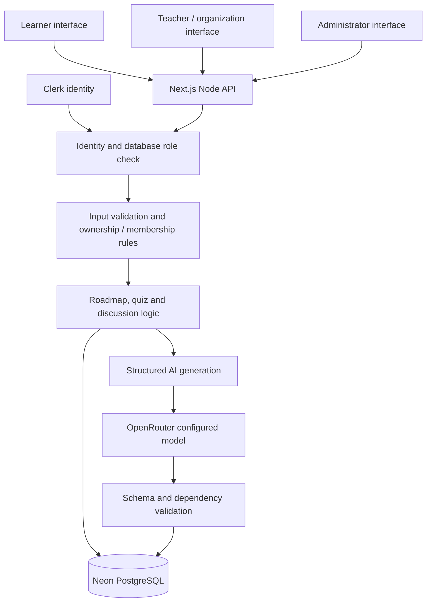

# How the Pathfinder backend works

This describes the implemented application, based on the current source. The learner navigation changes made on 10 October 2026 are local and unpublished. Previously deployed services and hosted acceptance results are recorded separately in `progress.md` and `tests/reports/deployment-live.json`.

## 1. Architecture and the three surfaces

Pathfinder is a Next.js application with a React interface and a Node.js backend. The learner, organization and administrator workspaces use the same API and database. Their different domains and pages guide navigation; server-side permissions decide what each person can actually access.

The API entry point is `src/app/api/[...path]/route.ts`. It dispatches requests to the roadmap store, quiz module and discussion module. Private API responses use `Cache-Control: no-store`. The deployment runs the backend on Vercel, so database credentials and AI keys stay on the server.

## 2. Authentication and authorization

Clerk establishes the signed-in identity. `currentUser()` reads its verified user ID, then loads the application role from `app_users`. New identities normally become learners. Initial administrator registration can use a server-configured ID allowlist; ongoing staff roles and organization memberships live in the database. Browser inputs cannot grant a role.

Authentication answers “Who is this person?” Authorization then answers “May this person perform this action on this record?” Both are checked on the server.

| Role | Implemented access |
| --- | --- |
| Learner | Own roadmaps, saved work, assignments, practice attempts and discussion transcripts; organization quiz participation |
| Teacher | Assigned learners within the same organization, submitted evidence review, assignments and permitted quiz sets/rooms |
| Organization owner | Organization overview, its learner records exposed through the organization API and organization quiz management |
| Platform administrator | Organization/account membership administration, feature flags, aggregate counts and redacted audit events |

A private roadmap query requires both its ID and `owner_id` to match the caller. Administrators do not bypass that ownership check. A missing or inaccessible private roadmap returns 404. Teacher actions also check organization membership and the assigned-teacher relationship. Page redirects are navigation helpers; they are not substitutes for these API checks.

Local development can use explicitly enabled, hashed-password accounts and PGlite storage. Those paths are disabled in production. Production does not silently fall back to local accounts or local database files when a managed service is missing.

## 3. Database and saved state

Production uses Neon PostgreSQL through the `pg` driver. Each reused application instance has a connection pool capped at five connections; this is not a platform-wide five-connection cap. `getDb()` reuses the initialized database connection layer. Transactions commit related changes together or roll them back on failure, and queries bind their parameters.

| Data | Purpose |
| --- | --- |
| `app_users`, `organizations`, `memberships` | Identity mapping, roles and organization/teacher relationships |
| `roadmaps` | Owner, intake, graph, progress marks, origin and current version |
| `revisions` | Immutable roadmap snapshots by version |
| `evidence`, `assignments` | Learner submissions, teacher feedback and assigned work |
| `advice`, `advice_locks` | Generated milestone guidance and temporary generation leases |
| `practice_attempts`, `error_notebook` | Diagnostic deadlines, results and revision notes |
| `quiz_sets`, `quiz_rooms`, `quiz_players`, `quiz_answers` | Authored content, room snapshots, participation and scored answers |
| `discussions` | Topic, AI personas, saved turns, status, version and feedback |
| `quotas`, `feature_flags`, `audit_events` | Usage limits, operator controls and action history |
| `roadmap_shares` | Revocable, explicitly shared read-only snapshots |

Graphs, intake, transcripts and structured advice use JSONB. User/organization relationships and ownership remain explicit columns. A function restart does not erase a saved roadmap, quiz answer or transcript. Hosted migrations are run explicitly; compatible code is shipped before an additive schema change.

## 4. Creating a roadmap, step by step

1. The learner sends the exact career goal, starting knowledge, weekly hours, target months and budget to `POST /api/roadmaps`.
2. The API checks the request origin, JSON body limits, signed-in role and Zod input schema. Goal length, numeric ranges and permitted budget/mode values are bounded. Creation has a separate hourly quota.
3. Manual mode creates a genuine learner-authored starting graph with a first skill and target role. AI mode checks configuration, the operator flag and the learner's AI allowance before contacting the provider.
4. The server sends the intake and planner instructions to the configured model. OpenRouter currently uses the user-selected `nvidia/nemotron-3-ultra-550b-a55b:free` model. The API key is never sent to the browser.
5. AI SDK structured generation parses the output against `graphSchema`. The current OpenRouter adapter supplies the schema as instructions and extracts JSON, because this model does not advertise native structured-output support. Application validation still decides whether output is acceptable.
6. Domain validation checks unique milestone/skill IDs, existing prerequisites, phase ordering, absence of dependency cycles and a path from every milestone to at least one role. An AI career graph also needs at least eight milestones, a skill, a project and two roles. The prompt requests approximately 12–16 milestones; that requested range is not a hard validator guarantee.
7. A schema-valid graph with a recognized semantic graph error receives at most one repair request. That request consumes another allowance slot, uses the same overall 120-second cancellation/deadline signal and must pass validation again. Provider/schema failures have no automatic retry. A second invalid graph is rejected.
8. Only a validated graph reaches `createRoadmap()`. A database transaction writes the roadmap, its initial revision and its creation audit event. The client receives the saved ID and opens the roadmap.

Failed generation does not replace existing plans. Failed provider attempts still consume quota. The normal default is ten AI requests in a rolling 24-hour window; the existing hosted demo was configured for twenty. The code bounds configurable allowance to 1–30. There is no automatic paid-model fallback.

## 5. Dependency logic and changing progress

Each milestone stores an ID, kind, phase, estimated hours, prerequisites, prerequisite mode, description and deliverable. A graph edge means “this milestone depends on that milestone.”

The availability rules are deterministic:

- A saved `known` or `complete` mark takes priority.
- A milestone with no prerequisites is ready.
- `all` prerequisites must all be marked known or complete.
- `any` prerequisites need at least one marked branch.
- Otherwise the milestone is locked, and the server rejects a completion mark.

Marking a skill already known does not ask the model to regenerate the roadmap. The mark changes, the remaining effort changes and dependency availability is recomputed from the same graph. Both progress marks are self-reported; teacher-approved work is stored separately.

The workload estimate is `ceil(total remaining milestone hours / weekly hours)`. It sums remaining work across parallel branches because one learner has a shared time budget. Illustrative example: 200 remaining hours at 10 hours per week gives 20 estimated weeks. This is a planning estimate, not a promise of employment or verified job readiness.

## 6. Revisions and conflicting edits

Updates include the version the learner last read. The store checks ownership and that version, then updates with a matching-version condition. A successful change increments the version and writes an immutable revision inside the same transaction.

If two tabs read version 4, the first update can create version 5. The second tab's version-4 write gets 409 instead of overwriting the newer work. The learner must refresh before retrying. This mechanism covers progress marks, milestone edits, new milestones and changed time/budget constraints.

Restoring a revision creates another revision rather than deleting history. Marks for matching milestones are preserved or recovered; saved evidence remains separate. Constraints change the schedule estimate without rewriting the graph's resource recommendations.

## 7. Milestone guidance and duplicate requests

Opening a milestone can request AI guidance: an explanation, actions, a concrete project, acceptance criteria, assessment questions and suggested searches. Search suggestions are explicitly unverified, because the planner does not browse the web.

The server first looks for saved advice keyed by roadmap ID, milestone ID and roadmap version. A cache hit avoids a provider call and a new quota charge. An uncached request must acquire a database lease for that exact key. Another request while the lease is held receives 409 rather than starting a duplicate generation. Leases expire so a crashed generation cannot hold the key forever.

The browser also deduplicates in-flight requests. Saved guidance is included in the owned-roadmap read and remains readable when new AI generation is paused. Since the key includes the revision, a progress/structure change can require fresh guidance. Advice generation has its own 120-second timeout; its current implementation does not combine the passed client request signal with that timeout.

## 8. Teacher review and administrator controls

Saving work attaches a note and an optional HTTPS link to a learner-owned roadmap milestone. The server validates the milestone and bounds the submission. A teacher can review that submission only through the assigned-learner and organization checks. Approval/feedback and assignments are persisted in PostgreSQL.

Teacher review does not turn self-reported progress into an accredited qualification. The teacher workspace exposes permitted evidence and overview data, not an unrestricted private-roadmap reader. Administrators manage memberships and feature switches and see aggregate counts/action records, not private learner prompts and plan contents through the admin API.

Flags can pause new roadmap generation, solo practice, quiz-room creation or discussion activity. Existing records remain readable. Discussion AI calls also use the shared AI preparation gate, so pausing roadmap generation currently blocks new provider calls used by discussion practice too.

## 9. Preparation, live quizzes and discussions

**Solo diagnostic:** The server creates a timed attempt and sends questions without answers/explanations. Submission is graded on the server and the final result is persisted once. Missed questions become notebook entries. Reopening an attempt reads its saved deadline/result rather than starting a fresh clock.

**Live quiz:** A teacher saves a validated question set. Creating a room copies its questions into an immutable room snapshot. Joining requires a room code, organization membership and consent to display the participant name. The host starts a room with a database timestamp. The current question/deadline is derived from that saved time and `clock_timestamp()`.

Answers are accepted in a transaction that locks the room, checks the current question and resolves the learner-specific opaque option ID. A unique room/user/question key prevents duplicate accepted answers. Closed-question answers return 409. Correct answers earn 1,000 points plus a bounded 0–500 time bonus; incorrect answers earn zero. The UI polls the API for room state and standings. Network arrival time can affect the speed bonus; production fairness/load acceptance is still an operating gate.

**AI discussion:** The learner chooses 3–5 simulated personas plus a moderator. The provider generates one structured round containing the expected persona responses followed by the moderator, rather than running separate autonomous agent services. After eligibility checks, the learner's turn is saved before round generation. Pause/finish changes the session version; a late response cannot be appended to a changed session. Provider failure preserves the submitted turn and pauses the session.

Final feedback must cover clarity, reasoning, collaboration and relevance and cite exact learner-turn substrings. Validation rejects invented quotes. Saved percentages measure text word counts, not speaking duration. Optional speech input/playback uses browser capabilities; the application does not store raw audio.

## 10. Security boundaries and operating limits

Mutating requests require an allowed same-host origin and JSON content type. The API limits JSON bodies to 64,000 bytes, including streamed bodies. Sensitive reads use ownership/membership checks. Known user errors have bounded messages; unexpected failures do not expose database connection strings, provider payloads or credentials. AI diagnostics record limited metadata rather than raw prompts/output.

Public sharing requires explicit consent and creates a revocable snapshot. It excludes intake, account name, progress marks and saved evidence, but the shared graph can still contain personal information typed into milestone text. Recipients can copy a shared snapshot, so revocation cannot erase copies they already made.

This is a deployed demo with verified hosted roadmap/database/security flows, not a completed enterprise operating certification. Clerk is currently a development instance. Owned-domain production identity, repository-owner Git auto-build connection, hosted load/fairness drills, restore/incident checks and browser/speech acceptance remain separate gates. This local UI change does not resolve or publish those gates.

## 11. A presentation explanation

“Our backend converts a specific career goal into a persisted dependency graph. It authenticates each request, checks who owns the data, validates model output and saves only a valid plan. Progress changes use ordinary graph logic, so existing plans remain usable when AI is unavailable. PostgreSQL revisions protect against conflicting edits, teachers review submitted work within their assigned organization, and preparation results and discussion transcripts stay attached to the learner account.”

Useful code references: `src/lib/auth.ts`, `src/lib/db.ts`, `src/lib/store.ts`, `src/lib/domain.ts`, `src/lib/ai.ts`, `src/lib/career-generation.ts`, `src/lib/openrouter.ts`, `src/lib/quiz.ts`, `src/lib/discussion.ts` and `src/lib/http.ts`.

## Private roadmap and reasoning practice, local extension

`/api/self-quizzes` is handled by `src/lib/self-quizzes.ts`. Every read and mutation requires the learner role and checks the owning learner ID in SQL. Generation snapshots the selected roadmap revision, skills and scope, then validates the AI output for count, scope, distinct questions/options and usable answer keys or rubrics. A bounded request has no automatic retry; failures preserve saved work. Previously generated stems are supplied to discourage repeats and exact repeats are rejected.

`self_quizzes` holds the frozen questions, explanations, key/rubric and scope. `self_quiz_attempts` holds a separate attempt, server-clock deadline, optimistic version, saved draft and final result. Draft writes reject stale versions and expired timers. Submission locks the attempt and freezes answers exactly once. After expiration, only the earlier saved draft is scored. Before submission, API projections omit the key, explanation, reference answer and rubric. New retakes reuse the quiz; editing the source roadmap does not mutate it.

Multiple choice is scored deterministically with no AI call. Written answers are persisted before feedback generation; a database lease admits one grader at a time. The grader must cover every answered question and rubric criterion, stay within saved points and cite an exact submitted-answer quote for every credit. Unanswered questions get zero without a provider call. A failed provider or invalid feedback leaves the submitted answers intact and releases the lease for retry. Completed results are returned from storage without another AI request.

Results contain points, percentages, topic scores and topics below 70%. The UI compares a retake to the earlier completed attempt of that same quiz. The dashboard/library summarize the most recent 50 attempts, not lifetime mastery. Missed questions populate `self_quiz_notes`; learners can add revision notes, reviewed marks and question flags. Operator views do not expose these private records. `personal_quizzes` pauses new generation/attempts; reads and existing answer submission remain available. Generation and written feedback share the existing daily AI quota. These are AI-assisted self-assessments, not externally reviewed exams or certifications.
