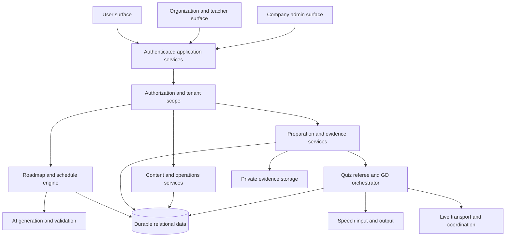

# Code to Career product and delivery plan

Created: 10 October 2026. Status: planning deliverable, implementation not started in this task. Working product name: Code to Career, inferred from the workspace name and replaceable without changing scope.

Build an enterprise-ready career planning and preparation platform around **Problem Statement 1, Reverse-Engineered Career Roadmapper**. The roadmap is the main product: a student describes an exact target role, receives a realistic AI-generated visual path, acts on its milestones, and updates the path as their circumstances and demonstrated skills change. Aptitude practice from Statement 3 and voice group discussions from Statement 2 follow the roadmap and help the student execute it. The product continues beyond the first demonstrable release into institution workflows, preparation depth, and enterprise operations.

Source: [Hackathon Problem Statements](/Users/yash113gadia/Downloads/Hackathon-Problem-Statements.docx). Read the main document, table, headers, footer, comments, revision markers, and embedded image. The image is the organizer logo. Paragraph references such as `P064` count all paragraphs in `word/document.xml`, including empty paragraphs and table cells. Source SHA-256: `cbc5ae36e0e46ebb8de25c2d10e1cd944c065a6d7909f894256df822c1ae88c9`.

Companion files: [progress.md](progress.md), [issues-changes.md](issues-changes.md), and [constraints.md](constraints.md). The constraints file separates organizer requirements, user requirements, and proposed engineering gates.

## 1. Product direction and scope

The main student journey is **target role → current abilities and limits → interactive roadmap → next action → practice or project → evidence and feedback → updated roadmap**. Organization staff can guide assigned students; company staff can operate the platform. Practice modules use the same skill taxonomy and progress model rather than becoming disconnected apps.

Submit and describe the project as Statement 1. Features borrowed from Statements 2 and 3 are additional preparation capabilities. The source says to pick one statement (`P003`); it does not say that borrowing useful features changes the submission track. Any organizer interpretation beyond that remains unconfirmed.

The intended audience is students preparing for jobs or internships, placement cells, colleges, training organizations, and teachers or mentors. The company admin surface means the company operating this product. A recruiting company portal is not assumed; recruiter partnerships can be considered later.

### Scope priorities

| Priority | What belongs here | Delivery rule |
| --- | --- | --- |
| A | Exact-role AI roadmap, interactive graph, actionable nodes, rerouting, persistence, safe input and access | Finish and verify before preparation expansions |
| B | Rich personalization, scheduling, evidence, sources, comparison, organization and operator workflows | Deliver as complete releases that preserve A |
| C | Solo preparation, full AptiQuiz, full GD Arena, career execution features | Connect results to roadmap milestones; each module has its own release gate |
| D | Enterprise identity, governance, reliability, operational automation and institutional integrations | Continue to a verified pilot; the first demo is not the end of the plan |

Security, ownership checks, privacy, mobile use, and accessibility start with the first release. Priority D adds operational depth; it does not postpone these fundamentals.

### Assumptions and unresolved facts

- Today’s session date is 10 October 2026. The source says the final freeze is **Fri 9 Oct, 10:00 am** (`P052`). The source does not state a year or timezone. Interpreting it as this year puts it before this session. No work performed now can be represented as work completed before that freeze.
- The repository submission deadline and Round 1 snapshot are referred to but not actually specified in the supplied document. Confirm those separately if competition eligibility is still relevant.
- Team size, available build hours, credentials, budget, hosting account, and expected institution count are unknown. Release order is firm; duration estimates are provisional.
- Recommend one TypeScript repository with three role-specific surfaces and shared services. A phone browser is supported; native mobile apps are later options.
- Provider recommendations below are not installed services. This request authorizes local planning files, not paid resources, uploads, a Git push, repository publication, or deployment.

## 2. The three surfaces

Use one identity per person and a surface switcher that only shows their authorized workspaces. A teacher can also be a learner. Roles attach to an organization or platform scope; they are not inferred from an email address or URL. The learner may belong to more than one organization without exposing unrelated personal work.

### User surface at `/app`

Primary navigation: Home, My Roadmaps, Today, Preparation, Evidence, Progress, and Settings.

- **Home and onboarding:** exact target role, current experience, known skills, weekly availability, target horizon, budget, learning preferences, and accessibility preferences. Make sensitive fields optional; do not require demographic details to generate a roadmap.
- **Roadmap workspace:** interactive graph, phase boundaries, prerequisite edges, alternate branches, critical path, progress, node search, fit-to-screen, zoom, pan, and a milestone detail panel. On a phone the panel becomes a full-height sheet while the graph remains interactive.
- **Today and calendar:** a small set of actionable tasks selected from available milestones, estimated effort, rescheduling, and explanations when the current target is infeasible.
- **Preparation:** node-linked aptitude, technical interview practice, project exercises, and GD sessions. Start from a roadmap recommendation or browse independently.
- **Evidence:** project links, rubric results, assessment attempts, mentor reviews, and a private portfolio. Public sharing is an explicit action with a preview of exposed fields.
- **Progress and control:** completed work, self-reported versus assessed skills, roadmap revision history, comparisons, notifications, AI disclosure, data export, and deletion controls.

### Company admin surface at `/admin`

Primary navigation: Operations, Organizations, Content, AI Quality, Usage, Support, Audit, and Settings.

- **Operations:** availability, failed generation jobs, dependency status, retry tools, errors by release, and feature switches. Retrying cannot create duplicate roadmaps or charge twice through application retries.
- **Organization management:** create and suspend tenants, manage plan entitlements, usage quotas, invite organization owners, and inspect onboarding state. Suspension rules must explain what happens to learner-owned data and active sessions.
- **Content management:** review skill taxonomy changes, resource references, question banks, rubrics, role definitions, and reported content. Changes are versioned and attributable.
- **AI quality and cost:** prompt and model versions, evaluation cases, output failures, source freshness, token usage, tenant budgets, and emergency capability shutdown.
- **Support and trust:** resolve a reported roadmap issue with the minimum required access. Student content access requires a scoped, time-limited, audited grant. Do not give every support agent unrestricted transcript access.
- **Audit and commercial operations:** permission changes, exports, content publication, support access, billing events when billing is introduced, and retention jobs.

Start with platform owner, scoped support operator, content reviewer, and aggregate analyst roles. Require stronger authentication for privileged staff; protect admin APIs as well as pages.

### Organization and teacher surface at `/org/[organizationId]`

Primary navigation: Overview, Cohorts, Learners, Assignments, Preparation Rooms, Reviews, Reports, and Organization Settings.

- **Organization owner or placement lead:** members, staff permissions, cohorts, invitations, organizational goals, consent settings, institution leagues, aggregate readiness and resource allocation.
- **Teacher or mentor:** assigned cohorts, skill-gap summaries, comments, roadmap suggestions, project review, assignment authoring, question-set management, hosted quizzes, and GD review where permitted.
- **Learner detail:** only assigned or explicitly shared work, with clear scope and access expiry. Feedback is attached to a milestone or evidence item, not a silent edit of the student’s goal.
- **Reports:** completion, assessment coverage, common skill gaps, difficulty analysis, attendance in hosted sessions, and exportable results. Distinguish absence of evidence from low ability.
- **Staff control:** organization-wide administrators and teachers have different powers. A teacher cannot grant themselves broader cohort access, change billing, or access another organization.

This surface is justified: it supports mentoring and directly hosts Statement 3’s faculty authoring and college league requirements. It does not need to be a separate application or identity system.

### Permission baseline

| Action | Learner | Teacher or mentor | Organization owner | Company staff |
| --- | --- | --- | --- | --- |
| Generate or replan a personal roadmap | Own work | Suggest changes to assigned/shared work | Assign goals, not silently replace personal goals | No default content editing |
| View private evidence or transcript | Own work | Only granted/assigned scope | According to explicit organizational sharing rules | Time-limited audited support grant |
| Publish personal portfolio or roadmap | Own explicit action | Cannot publish for learner | Cannot publish for learner | Cannot publish for learner |
| Host aptitude room | If entitled | Assigned organization | Own organization | Operational control under separate permission |
| Manage members and teacher access | No | No | Own organization | Platform-scoped organization operations |
| Change prompts, budgets or global flags | No | No | Tenant budget/preferences only | Separately authorized platform role |
| Export reports | Own data | Assigned scope | Own organization scope | Audited scope, aggregate by default |

Every request checks authenticated identity, membership, action permission, and resource scope on the server. A hidden navigation item is not an authorization check.

## 3. Statement 1 requirement coverage

| Source requirement | Feature IDs | First release | Required proof |
| --- | --- | --- | --- |
| Hyper-specific role input and AI-generated phases, skills, intermediate roles and timeline (`P064`, `P069`) | RD-01, RD-02 | R1 | Two substantially different new inputs produce valid, relevant AI graphs through the real backend |
| Creative visual with zoom, pan and clickable milestones (`P065`, `P071`) | RD-03 | R1 | Exercise all interactions on laptop and phone; a plain list is insufficient |
| Dynamic, concrete advice on a clicked node (`P066`) | RD-04 | R1 | A node-specific AI response gives a project, steps and a way to judge completion |
| Already-known skills automatically update subsequent nodes (`P067`) | RD-05 | R1 | Mark a prerequisite known; observe changed available steps and remaining timeline; refresh retains the change |
| Realistic roles, certifications and target-specific projects (`P070`) | RD-02, RD-06 | R1 | Review supported claims and resources; generic or invented credentials fail the gate |
| Optional limits, real paths, progress, comparison and export (`P077`–`P081`) | RD-07 to RD-13 | R2, with basic progress in R1 | Verify each enabled enhancement as a user flow |

R1 must deliver a complete version of Statement 1’s core, including dynamic node advice and rerouting. R0 is setup and has no demo acceptance claim. Preparation never substitutes for a missing core requirement.

## 4. Roadmap feature catalogue

### Generation and visual planning

| ID | Feature | Behavior and completion condition |
| --- | --- | --- |
| RD-01 | Exact-role intake | Accept role, domain, company type, location preference where relevant, seniority, and optional pasted job description; validate length and missing intent |
| RD-02 | Reverse-engineered path | AI generates logical phases, skill dependencies, plausible intermediate roles, concrete projects, optional credentials, effort ranges, assumptions and final-role requirements |
| RD-03 | Interactive skill graph | Branching graph with zoom/pan, selectable nodes, meaningful edges, phase grouping, progress and stable layout; preserve viewport on progress updates |
| RD-04 | Actionable node coach | On-demand AI advice uses target, skill level and limits; returns a specific exercise, implementation steps, resources and acceptance rubric, with cache/version control |
| RD-05 | Dynamic rerouting | Known/completed skills update availability and schedule automatically; structural replans preserve evidence and show the difference before replacement |
| RD-06 | Resource and claim grounding | Reference reviewed official resources where available; attach URL, checked date, relevance and verification state; label unsupported claims instead of inventing links |
| RD-07 | Personal baseline | Separate self-reported experience, diagnostic results and mentor-verified competence; optional diagnostics refine the route without blocking initial planning |
| RD-08 | Time and budget planner | Fit work to weekly hours, deadlines, holidays and course affordability; offer an honest alternative when constraints cannot be met |
| RD-09 | Progress and unlocks | Milestones have not-started, available, in-progress, completed, known and needs-review states; celebrate progress without claiming employment readiness from clicks |
| RD-10 | Alternative routes | Offer internship, adjacent-role, project-first and credential routes when relevant; explain tradeoffs and shared prerequisites |
| RD-11 | Role comparison | Compare two goals using canonical skill IDs; show overlap, added effort, intermediate-role differences and preserved completed work |
| RD-12 | People and pathway evidence | Display documented, consented or public referenced trajectories; clearly label hypothetical examples. Never fabricate alumni, outcomes or personal stories |
| RD-13 | Share and export | Export a readable image and create a revocable share snapshot; private evidence, personal profile and transcript are excluded by default |

### Ongoing career execution

| ID | Feature | Behavior and completion condition |
| --- | --- | --- |
| RD-14 | Today’s action plan | Rank available tasks by prerequisites, time budget and target relevance; explain each recommendation and allow rescheduling |
| RD-15 | Project studio | Turn a milestone into a scoped project brief, rubric, checkpoints and portfolio evidence; teacher review is optional and attributable |
| RD-16 | Job-description gap analysis | Treat pasted job text as untrusted data; compare its requirements to evidence, distinguish essential versus preferred skills, and propose a roadmap revision |
| RD-17 | Revision history and recovery | Immutable published revisions, changed-node explanations, undo to a prior revision, and conflicts handled without losing completed evidence |
| RD-18 | Roadmap-aware assistant | Answer questions about the current route, explain prerequisites, and propose changes; require user action before modifying a published plan |
| RD-19 | Readiness by dimension | Show skill coverage, project evidence, aptitude and communication separately, with sample size and recency; explain every calculated indicator |
| RD-20 | Mentoring and checkpoints | Scheduled reviews, node comments, suggestions and approval of evidence; the learner sees who reviewed what |
| RD-21 | Replanning triggers | Missed deadlines, changed goals, new evidence or long inactivity can prompt a revised plan; avoid destructive automatic rewriting |
| RD-22 | Career opportunities | Later, match opt-in learners to current verified internships or roles with source dates; expired listings are removed and no placement guarantee is made |
| RD-23 | Retention without pressure | Optional reminders, weekly reflection, daily practice and forgiving streaks; no punishment for breaks or compulsory public rankings |
| RD-24 | Languages and accessible navigation | Localizable content, keyboard-operable graph and readable companion outline; retain the graph as the required primary visualization |

Ship RD-01 to RD-06 and basic RD-09 in R1; RD-07 to RD-13 plus RD-14 and RD-17 in R2. Expand RD-15, RD-16 and RD-18 to RD-24 in R4, R7 and R8 according to the release plan. Real-people evidence is conditional on obtaining honest sources; a clearly labeled example is not claimed as a verified path.

### Roadmap engine design

1. Validate the target and bounded profile inputs. Do not require a resume or voice sample for the first roadmap.
2. Normalize known skills into a versioned skill taxonomy, retaining the learner’s wording and confidence. Generic skill taxonomy entries are reusable; a finished roadmap is generated for the user’s input.
3. Ask the AI for a bounded structured graph. Proposed initial limit: 12–30 visible milestones, with a hard cap of 80 nodes and grouped expansion for complex routes. These are design limits to test, not measured model performance.
4. Validate the full response on the server: schema, unique IDs, known enum values, existing edge endpoints, no prerequisite cycles, reachable terminal goal, consistent phase ordering, plausible nonnegative effort ranges, and no unsupported executable HTML.
5. Check hard prerequisites and branch semantics. Store whether incoming prerequisites mean all-of or any-of; do not treat an alternative route as another mandatory step.
6. Compute layout, available tasks and schedule deterministically from the validated graph. AI proposes realistic effort ranges; code calculates calendar placement and feasibility from them. Return the assumptions and ranges alongside the timeline.
7. Persist a validated revision atomically. A streaming partial response may show generation status; it is not a published roadmap until validation succeeds.
8. If generation fails, allow a bounded repair/retry and keep the previous valid revision. Show a recoverable error for a first-time user; never silently present a fixed roadmap as a successful generation.

Marking a skill already known persists a self-report event, satisfies eligible prerequisite conditions, reduces remaining work, and updates downstream task availability immediately. It does not erase the node or label the skill independently verified. An optional AI structural replan can then improve the route; failed replanning leaves the deterministic update functional. Completed milestones, evidence and canonical skill mappings survive new graph IDs through explicit migration mappings. Ambiguous mappings are shown for review.

Use optimistic concurrency on roadmap revisions. Two devices editing the same roadmap must get a conflict or a safely merged progress event, never a silent last-write deletion of evidence.

## 5. Preparation after the roadmap

Preparation is launched from relevant nodes and stored against skills and evidence. A weak aptitude topic creates a recommended practice task; it does not automatically declare an unrelated engineering skill absent. A GD report contributes communication evidence; it does not modify technical completion. Evidence promotion follows a published rubric and can require a teacher review.

### Solo preparation and career practice

| ID | Capability | Roadmap connection |
| --- | --- | --- |
| PR-01 | Baseline aptitude and skill diagnostics | Identify supported gaps and choose initial preparation tasks |
| PR-02 | Topic drills and timed mock tests | Quantitative, logical, verbal and data interpretation practice; review explanations and weak topics |
| PR-03 | Spaced review and error notebook | Turn incorrect attempts into revision tasks with due dates and explanations |
| PR-04 | Technical interview practice | Node-specific questions, follow-ups, rubric feedback and past-attempt comparison |
| PR-05 | Project and coding preparation | Concrete project milestones and code-review rubric; arbitrary code execution requires a separate isolated sandbox gate |
| PR-06 | Resume and portfolio preparation | Evidence-backed bullet suggestions, portfolio completeness and role-specific gap checks; never invent experience |
| PR-07 | Placement and application planner | Mock placement sequence, deadlines, applications and learner-controlled reminders |
| PR-08 | Preparation analytics | Accuracy, speed, topic coverage, evidence quality and communication trends, with confidence and attempt count |
| PR-09 | Teacher assignments and review | Assign a skill, drill or project to a cohort; collect work and deliver scoped feedback |
| PR-10 | Daily practice and study groups | Optional streaks, short challenges and peer sessions with private alternatives |

R4 delivers a working loop for PR-01, PR-02, PR-03, PR-04, PR-08 and PR-09. R7 adds the remaining career preparation depth. Do not ship a “coding arena” until a real isolation boundary has been verified; project briefs and reviewed submissions can be useful before code execution exists.

### AptiQuiz from Statement 3

The full module retains the original brief’s real-time, fairness and institutional requirements. A solo quiz in R4 is not advertised as the completed AptiQuiz module.

| ID | Capability | Source and acceptance condition |
| --- | --- | --- |
| AQ-01 | Question authoring | Text, options, answer, topic, difficulty, optional image/table; edit, reorder, reuse, review and version sets (`P115`) |
| AQ-02 | Room and lobby | Authorized host, short join code, names/aliases, visible lobby, host start and capacity up to 50 (`P116`, `P126`) |
| AQ-03 | Synchronized play | Server start/end, common question, countdown, one accepted response, reveal after close or all eligible players answer (`P117`, `P122`) |
| AQ-04 | Speed and accuracy scoring | Published deterministic rules, wrong answer policy and fair tie handling (`P118`) |
| AQ-05 | Leaderboard and final report | Rank movement, accuracy, average accepted response time and topic strengths (`P119`) |
| AQ-06 | College league | Room belongs to an organization; comparable approved games feed player and institution period standings (`P120`) |
| AQ-07 | Reconnection | Refresh/disconnect recovers player identity, accepted answers, score and current state (`P124`) |
| AQ-08 | Fairness and cheating resistance | Options shuffled per player, answer hidden before reveal, late/duplicate answers rejected, delay handling documented (`P123`, `P125`) |
| AQ-09 | 50-player proof | Reproducible simulation script committed, run command and real results in README (`P126`, `P128`, `P129`) |
| AQ-10 | Faculty reporting and spectator mode | Wrong-answer patterns, scoped CSV export and sanitized projector view (`P133`, `P135`) |
| AQ-11 | Team battles, daily challenges and seasons | Teams of 3–5, topic leagues and streaks; rules fixed before a ranked session (`P131`, `P132`) |
| AQ-12 | Adaptive and accessible play | Adaptive difficulty, large text, color-safe states, low-data mode and sound controls (`P136`, `P137`) |

Limited power-ups from `P134` can follow R7. Keep them out of comparable ranked leagues until their scoring effects are defined and tested. Adaptive room difficulty is unranked initially; score comparisons across different sets need normalization or separate leagues.

#### Aptitude referee and fairness design

- Persist a state machine: lobby → scheduled → active question → reveal → next question → completed, plus paused/cancelled states. Host commands use version checks and idempotency keys.
- Store room membership, question instance, server timestamps, accepted answers and scores durably. Question sets are snapshotted at room start; editing the authoring set cannot change a live game.
- Use a future common start time after clients report readiness, and estimate display clock offsets using server-issued heartbeats. Device clocks only display the timer. A background referee closes rounds even if the host disconnects; persisted deadlines and a lease prevent duplicate referees after restart.
- Accept an answer only if the authenticated/signed player is a member, the question is active, its server receipt time is before the persisted cutoff, and there is no accepted answer for that player/question. Enforce uniqueness in storage as well as code.
- Map player-visible shuffled option IDs to canonical option IDs on the server. Correct answers and explanations are excluded from player payloads, event streams and caches until reveal.
- Proposed scoring: wrong/unanswered = 0; correct = 1,000 accuracy points plus 0–200 speed points. Calculate speed in coarse one-second bands from server receipt elapsed time, with a capped server-measured latency adjustment. Freeze the adjustment before a question, use a conservative low percentile of multiple RTT samples, and cap half-RTT adjustment at 150 ms. These numbers are proposed defaults to validate, not organizer rules.
- Never accept a client-submitted time as proof. Delayed heartbeat responses cannot move the deadline or create unlimited compensation. Equal scores share a rank; do not secretly break ties using arrival order.
- Network fairness is necessarily bounded: server RTT estimation cannot prove exactly when a person clicked or remove asymmetric delay. Test representative connections and document residual boundary cases. If comparable answers regularly score differently, reduce speed weighting or broaden bands before enabling ranked play. No claim of perfect fairness is justified by this design alone.
- Private rooms authorize channel access; guessing a join code does not grant host powers. Guests, if enabled, receive signed room-scoped reconnect identity. League entries require verified organizational membership, not a player-entered college name.

Run 50-player tests against the actual deployed candidate as well as locally. Exercise simultaneous answers, wrong answers, slow links, duplicate/replayed submissions, deadline boundaries, disconnect/rejoin, host loss and referee restart. Validate server scores and snapshots, not only UI presence counts. Publish the script and measured results without secrets or private participant data.

### GD Arena from Statement 2

| ID | Capability | Source and acceptance condition |
| --- | --- | --- |
| GD-01 | Room setup | Topic list/custom topic; 3–5 AI panelists plus moderator (`P090`) |
| GD-02 | Spoken interaction | Live student transcription; AI responses spoken with distinguishable personalities and, where possible, voices (`P091`, `P096`) |
| GD-03 | Natural turn management | Wait for pauses, avoid simultaneous panel speech, stop playback/generation when student interrupts, and panelists respond to one another (`P092`) |
| GD-04 | Moderated structure | Opening, visible timer, participation management and closing round (`P093`) |
| GD-05 | Transcript-linked feedback | Speaking distribution and specific feedback with valid quoted transcript moments (`P094`) |
| GD-06 | Failure recovery and disclosure | Denied mic, lost connection and failed AI call are handled; every AI participant is clearly labeled (`P097`, `P098`) |
| GD-07 | Formats and languages | Case, abstract, debated topics, watch-first fishbowl and tested Hindi-English support (`P100`, `P101`) |
| GD-08 | Coaching and replay | Silent nudges, missed-opening replay and cross-session habits (`P102`, `P103`, `P105`) |
| GD-09 | Friends and AI-filled seats | Human invitation, explicit consent and AI seat filling (`P104`) |
| GD-10 | Accessibility | Live captions, adjustable pause threshold, mute/output controls and keyboard operation (`P106`) |

#### Voice and feedback design

Use a single room orchestrator with per-persona instructions, a moderator policy, and a serialized floor queue. The initial complete module can use streaming speech recognition → text reasoning → streaming speech synthesis. Evaluate the actual delay; consider a unified voice model only if its turn control, costs and transcript evidence pass the same gates. Speech services must be provisioned and exercised before describing the room as live.

Maintain states for listening, endpointing, thinking, speaking, interrupted, reconnecting and ended. Student speech has priority. An interruption cancels queued output, stops audio promptly and records only the spoken portion of a response as heard; generated but unheard text must not become transcript evidence. Guard against a stale response resuming after cancellation.

Give panelists different speaking goals and habits, not just names. Select the next speaker using recent participation and the conversation context. Explicitly test panelist-to-panelist disagreement, a quiet participant and a student interruption. A moderator must not monopolize the room.

Persist transcript turns with speaker, start/end, stable turn ID and transcription confidence. Feedback cites turn IDs and exact quote spans; validate quote matches and flag uncertain transcription. Report no evidence when a criterion has no supporting moment. “Listening” feedback should refer to observable responses, not claims about attention or personality. Do not use accent as a proxy for reasoning ability.

Raw audio is not retained by default. Clearly explain transcription storage and any optional recording before microphone use. Proposed transcript retention is 30 days for personal practice, configurable for a tenant subject to a verified policy. This is a product proposal, not a hackathon rule. Revocation/deletion must cover application storage and supported provider retention controls.

If mic permission is denied, offer retry instructions and a clearly labeled text practice alternative. Text practice is useful but is not accepted as proof of the voice module. If a provider fails, preserve the session, show the failure and let the user retry or end with a partial report.

## 6. Architecture and technology recommendation

Start with a modular application, not a distributed system for every feature. Keep roadmap generation, content, organizations, assessment, reporting and permissions as clear modules with shared validated contracts. Introduce a separate runtime only where persistent room orchestration requires it.

| Component | Recommended choice | Why and verification boundary |
| --- | --- | --- |
| Web application | Next.js App Router, TypeScript, current supported React, one repository | Three layouts and shared server services; [App Router documentation](https://nextjs.org/docs/app) |
| Graph | React Flow with a deterministic DAG layout | Appropriate node/edge interactions; preserve its keyboard support and verify our custom nodes using [React Flow accessibility guidance](https://reactflow.dev/learn/advanced-use/accessibility) |
| Validation | Shared runtime schemas, with Zod as the proposed library | Validate AI output, forms, APIs and events; pin versions during implementation |
| Identity | Clerk as the proposed initial managed integration | Use current [Next.js setup](https://clerk.com/docs/nextjs/getting-started/quickstart); authentication does not replace our resource permission checks |
| Durable data | PostgreSQL through proposed Neon integration, typed migrations | Relationships, transactional revision publishing, permissions and quiz answers; Neon is listed in [Vercel Integrations](https://vercel.com/docs/integrations) |
| AI | AI SDK with Vercel AI Gateway for text/structured generation | Proposed routing entry point; [AI Gateway documentation](https://vercel.com/docs/ai-gateway). Select real model IDs after a quality/cost evaluation, not from memory |
| Files | Private object storage, proposed Vercel Blob on this host | Only introduce when private evidence or media uploads are needed; verify upload limits, access and deletion before launch |
| Hosting | Proposed Vercel deployment for the web app, default Node runtime | Hosting is a recommendation, not a deployed environment; verify package/runtime compatibility when scaffolding |
| Live rooms | Shared durable referee/orchestrator plus WebSocket transport and external coordination | Run a deployment spike before R5; never depend on a single function instance for room state |
| Cross-instance coordination | Redis capability when needed for rooms/rate limits, proposed Marketplace-managed integration | PostgreSQL remains the canonical answer/score store; prove disconnect and failover behavior before ranked play |
| Jobs and observability | Durable jobs for generation/reports/deadlines, structured redacted logs and health metrics | Select/provision real integrations at the relevant release; no promises about delivery or dashboards before verification |

Vercel’s [WebSocket documentation](https://vercel.com/docs/functions/websockets) supports WebSocket handling but warns that connections end at function duration limits and reconnects can reach different instances. It also identifies the Next.js upgrade helper as experimental. Therefore, platform support alone is not a reliability proof. R5 must test reconnect, shared pub/sub, scheduler recovery and deployment turnover; use a separately deployed stable room service from the same repository if the spike fails those conditions.

Provider discovery through `vercel integration categories` failed in this session with a cache permission error and `Failed to fetch integration categories: fetch failed`. No discovery result, resource, secret, account or integration is claimed as configured. Repeat read-only discovery before implementation, then provision the approved integrations before building against them. Do not introduce a simulated AI backend or fake provider success to bypass credentials.

Installed Vercel CLI was verified as **58.4.0**. Strong recommendation: upgrade using `npm i -g vercel@latest` (or the team’s chosen package manager equivalent) before provisioning, for current integration and agent tooling compatibility. No global upgrade was performed. Use a supported Node LTS version and pinned package versions at implementation time; no runtime is installed by this document.

### Logical dependency diagram



### Proposed repository organization

```text
src/app/                         user, admin, organization and public layouts/routes
src/modules/identity/            identity mapping and membership lifecycle
src/modules/authorization/       action and resource policies
src/modules/roadmaps/            AI contracts, graph validation, revisions, scheduling
src/modules/preparation/         attempts, rubrics, assignments and recommendations
src/modules/aptitude/            authoring, room referee, scoring and league rules
src/modules/discussions/         voice orchestration, transcript and feedback
src/modules/organizations/       cohorts, staff roles and invitations
src/modules/operations/          flags, usage, audit and support grants
src/contracts/                   runtime schemas and public event/API payloads
src/db/                          schema, scoped queries and migrations
src/integrations/                real provider clients and version-specific configuration
tests/                          policy, graph, state-machine and browser flow tests
scripts/                        seed isolated demo data and simulate 50 players
```

These are proposed paths, not files already created. Keep reusable logic outside route handlers. Server services own permissions and transactions; client components own graph interaction and media controls. Avoid caching private responses across users or tenants.

## 7. Data model and contracts

Build tables when their feature ships; the table list is a design contract rather than a demand to create all schema on day one.

| Domain | Main records | Important invariant |
| --- | --- | --- |
| Identity and tenancy | users, organizations, memberships, cohorts, cohort_members, staff_assignments, sharing_grants | Membership is server-verified; personal and organizational scopes remain explicit |
| Goals and skills | career_goals, learner_profiles, skills, skill_aliases, skill_evidence | Self-report and verified evidence are distinguishable |
| Roadmaps | roadmaps, roadmap_revisions, nodes, edges, node_progress_events, node_advice | Published revision is immutable; references stay within its roadmap/revision |
| Resources and content | resource_references, role_definitions, rubrics, content_versions | Sources have review/expiry metadata; changes are attributable |
| Preparation | assignments, question_sets, question_versions, attempts, attempt_answers, evidence_items, mentor_reviews | Attempts use the content version seen at the time |
| Aptitude rooms | rooms, room_players, room_questions, accepted_answers, score_events, league_periods, league_entries | One accepted answer per player/question; scores derived by server rules |
| GD sessions | discussion_sessions, participants, transcript_turns, feedback_reports, audio_assets_if_opted_in | Feedback refers to existing heard turns; recordings require opt-in |
| Operations | generation_jobs, usage_ledger, audit_events, feature_flags, entitlements, support_access_grants | Retries are idempotent; sensitive access is scoped and recorded |

Every learner-owned resource has an owner. Every organizational resource has an organization scope. A personal roadmap may have no organization, with explicit grants for sharing. Child records inherit scope through enforced relationships; they cannot point at a parent in another tenant.

Roadmap output includes `schemaVersion`, target, assumptions, phases, nodes, edges, prerequisite semantics, effort ranges, resource references and verification state. Server-added metadata includes owner, revision number, prompt/model version, timestamps and generation trace ID. The AI cannot assign its own authorization scope.

API mutations use validated inputs, idempotency where retries have effects, and version preconditions where simultaneous changes could overwrite data. Public payloads are explicit allowlists, not raw database records. Events carry room/resource ID, monotonic sequence, contract version and server time. Reconnection obtains a fresh authorized snapshot and resumes after its sequence; late or reordered events do not roll the UI backward.

Apply row-level policies as defense in depth with a restricted application DB role. PostgreSQL documents that superusers, `BYPASSRLS` roles and usually table owners bypass policies; tests must use the actual runtime role, not an owner connection. [PostgreSQL row security documentation](https://www.postgresql.org/docs/current/ddl-rowsecurity.html).

## 8. Enterprise quality and operating gates

“Enterprise grade” is the intended standard, not a present claim. A release is only called production-ready after its scope-specific checks pass. An enterprise pilot additionally requires operational and organizational evidence.

| Area | Start with the first release | Extend before enterprise pilot |
| --- | --- | --- |
| Access and tenancy | Authenticated ownership, server authorization, two-tenant denial tests, private-by-default content | Enterprise SSO where required, stronger staff authentication, scoped access reviews and provisioning/deprovisioning |
| Data protection | Minimize input data, AI disclosure, redacted logs, safe URLs/uploads, no secrets in client/repo | Verified retention/deletion, tenant export, backup access controls and approved provider data handling |
| AI safety and quality | Schema/DAG checks, bounded inputs, untrusted-text isolation, no fabricated credentials, recoverable failures | Evaluation suite, reviewed prompt rollout, source freshness, drift monitoring and human escalation |
| Reliability | Persistent progress, idempotent generation, bounded retries, dependency errors and last valid revision | Restore drills, room failover, incident runbooks, monitoring/alerts and tested capacity |
| Release control | Reviewable changes, candidate checks, flags off by default, prior release usable | Controlled rollout by tenant, migration compatibility, deployment audit and recovery rehearsal |
| User experience | Phone layout, labels, keyboard operation, contrast, loading/empty/error states | Accessibility audit, tested localization, slow-device and low-bandwidth validation |
| Commercial operations | Per-user/tenant AI limits and usage visibility | Entitlements, billing if needed, cost reconciliation and explicit cancellation behavior |
| Reporting | Transparent progress and evidence | Metric definitions, cohort comparisons with small-group privacy thresholds, outcome tracking without invented causation |

Proposed pilot targets: 99.9% monthly availability for the core roadmap service; p95 ordinary authenticated reads under 1 second under an agreed load; p95 publishable roadmap generation under 30 seconds or a clearly visible resumable job; p95 GD response audio start within 2 seconds after an accepted pause; 50 players per aptitude room. These are acceptance targets to benchmark and revise with evidence, not achieved measurements or organizer SLAs.

Proposed recovery targets: restore roadmap/progress data with RPO at most 24 hours and RTO at most 4 hours for the first institutional pilot. Live room accepted answers should survive process restart without loss; that needs durable commits before acknowledgment. Confirm purchased database backup capability and run a restore into an isolated environment before claiming either target.

AI budgets reserve estimated spend before expensive jobs, record actual usage when available, and cap retries. When quota is exhausted, existing roadmaps and completed results remain readable; new AI work reports the limit. Analytics and logs use identifiers and metadata by default, not full resumes, transcripts or prompts containing personal data.

## 9. Releases that remain working while the next feature is built

The release sequence protects the user’s requirement that completed features remain live and functional. Each release is a complete user journey with a tagged known-good revision, evidence, and an isolated candidate for subsequent work. No release is promoted merely because its screens exist.

| Release | Complete deliverable | What can be shown if work stops here | Gate before enabling |
| --- | --- | --- | --- |
| R0 | Real credentials, selected integrations, reproducible local setup, auth/database/AI smoke checks, deployment feasibility | Setup only; not a qualifying main-flow demo | Real authenticated read/write and real bounded AI call; secrets excluded |
| R1 | Full Statement 1 core: exact target, AI graph, interaction, dynamic advice, known-skill reroute, saved progress | A new role becomes a usable, persisted interactive roadmap | Entire core flow on laptop/phone, two goals, failure recovery, ownership checks |
| R2 | Personal baseline, constrained scheduling, alternative paths, comparison, sources, revision history, private sharing/export and Today | A realistic personal plan that changes with time and skill evidence | Constraint feasibility, no evidence loss, revoked sharing, export and comparison checks |
| R3 | Functional company and organization surfaces, staff/cohort permissions, assignments, content review, audit and usage overview | Learner and teacher workflow plus company operations | Two organizations, learner/teacher/admin accounts, denial cases and real persisted feedback |
| R4 | Solo diagnostics, timed drills, interview practice, error notebook and roadmap-linked results | Roadmap → practice → report → new recommended task | Known-answer grading, attempt history, rubric/source checks and permissions |
| R5 | Complete Statement 3-derived AptiQuiz, 50-player rooms, reconnect, authoring, leaderboard and college leagues | Teacher-hosted live aptitude with trustworthy results | Actual 50-player run, fairness tests, no answer leak, duplicate/late rejection, restart recovery |
| R6 | Complete Statement 2-derived spoken GD with 3–5 AI panelists and moderator, transcript-linked feedback | A live voice discussion that produces actionable evidence | Real microphone/audio, interruptions, panelist-to-panelist turns, exact quotes, denied-mic/provider-loss tests |
| R7 | Advanced preparation, projects/portfolio, resume/application planning, mentoring, GD variants, quiz teams/seasons and deeper insights | End-to-end career preparation across individual and institution use | Each extension independently verified and connected to evidence; no unsafe code execution |
| R8 | Enterprise pilot: stronger identity, governance, restore/failover drills, capacity, cost and operating runbooks, selected institutional integrations | A supported institutional deployment with verified controls | Pilot checklist, support exercise, tenant isolation, backup restore, observability and agreed operating targets |

R3 will be the first release where all three surfaces provide meaningful workflows. R1 and R2 are earlier safe demonstration checkpoints, not the finished three-surface product. R8 is a required delivery horizon for the enterprise objective, not a list discarded after the demo.

### How to protect each working release

1. Maintain a stable branch/revision and separate feature branches or isolated checkouts. Development data, keys and tenants are separate from the live environment.
2. After a release passes, record its exact commit, migrations, enabled flags, environment, test evidence and known limitations in `progress.md`. Tagging/publishing occurs only with the required authorization.
3. New capabilities default off, both in navigation and server APIs. A disabled feature cannot be invoked by manually calling its endpoint. Disabled feature code must still compile and pass dependency checks.
4. Add schema and contracts compatibly. Create new nullable fields/tables, deploy compatible readers/writers, backfill through a resumable job, validate, then tighten constraints later. Do not remove old fields while the stable release still needs them.
5. Keep candidate hosting and candidate data isolated. A broken candidate build leaves the last live deployment serving. A preview shares neither production write credentials nor real student data by default.
6. Re-run the Statement 1 core smoke flow for every candidate, even when only a preparation feature changes. Also test the affected surface and permission boundaries.
7. Promote only a passing candidate; monitor it and keep a known rollback target. For writes/schema changes, use a forward repair or flag shutdown when an old binary would be incompatible. A deployment rollback does not undo database changes.
8. If the new feature fails its gate, keep it disabled and continue demonstrating the previous verified release. Track the failure honestly in the README and progress log.

### Scope and time control

Use approximately 60% of feature-building effort for roadmap depth and its three-surface workflow until R3 is stable. Reserve at least 20% of every short delivery window for verification, deployment readiness, README and presentation. These are proposed planning guardrails, not measured capacity.

For a genuinely short confirmed window, the order is R1 → the most useful complete R2 enhancements → R3’s smallest real teacher/admin workflow → R4’s smallest real preparation loop. R5 and R6 proceed only if there is enough time to pass their full gates; unfinished modules stay disabled. Do not substitute a text chatbot for the spoken GD room or an untested lobby for AptiQuiz.

Illustrative estimates for experienced builders with credentials already available: R1 may take 12–24 person-hours; R2 12–24; R3 16–32; R4 16–32; R5 32–64; R6 40–80; R7 40–80. R8 can require several further weeks of implementation, drills and pilot operation. These are rough planning ranges, not elapsed-time promises; dependency delays and integration discoveries can expand them. Re-estimate after R0 and the first real vertical flow. A complete enterprise platform plus two real-time modules is not honestly promised within the document’s unspecified remaining hackathon window.

If staffing allows, give human builders clear ownership of roadmap/backend, visualization/user flow, and organization/preparation/testing, with shared integration review. This is team planning, not an instruction to spawn autonomous agents. Do not split work into incompatible schemas or three separately maintained apps.

## 10. Verification and demo acceptance

### Core roadmap proof

Use at least two different targets such as “Full Stack Developer at a climate tech startup” and “UI/UX Designer for fintech apps.” Enter them through the real UI and backend. Confirm that graph structure and advice respond to the target, that resources do not claim unsupported facts, and that known skills reroute subsequent work. Refresh and sign in again to confirm persistence. Test malformed inputs, unknown node IDs, repeated requests, a failed AI response and another user requesting the same resource.

The graph must support actual zoom/pan/click, keyboard node access and a usable phone layout. A companion outline helps accessibility but cannot replace the primary interactive visualization.

### Surface and enterprise proof

Create isolated test organizations A and B, learners in each, a standalone learner, a teacher assigned to only one cohort, an organization owner and a restricted company operator. Attempt permitted actions and cross-scope actions directly against APIs. Verify no leaked names, evidence, room answers, transcript snippets or cached private content. Exercise permission removal during an active session and report export.

Use meaningful tests for graph invariants, concurrency, scheduling, scoring, room state transitions, transcript quote validation and authorization. Use browser tests for the actual journey. Typechecking/build success alone does not establish the feature works. Run load and restore checks only when the corresponding capability exists and record real outputs.

### Demo checkpoints

**Round 1, about 3 minutes:** enter an exact role; generate a new graph; zoom/pan/open a node; obtain concrete advice; mark a skill known and show the reroute; refresh to demonstrate saved work. If available, briefly show a teacher review and a preparation recommendation without displacing the core.

**Final, 6 minutes of presentation/demo plus 4 minutes of questions:** explain the student problem; demonstrate the roadmap and its adjustment; show the organization workflow and only verified preparation modules; present architecture, evidence of reliability and honest limitations. Include problem, demo, architecture and learnings in the PPT, as required by the source. A recorded backup can show the verified release if deployment fails, but is not described as a currently working live deployment.

Both timings describe the original event rules, not confirmation that those rounds are still open. Follow [constraints.md](constraints.md) for actual eligibility and submission uncertainties.

## 11. Implementation kickoff and ongoing documentation

The next implementation task starts with R0: reconcile event timing if necessary, verify the repository creation/commit history before any competition claim, confirm credentials and budget, upgrade/check tooling, discover and provision approved integrations, and exercise real auth/database/AI connections. Then build R1 as the first vertical slice.

During implementation, update `progress.md` after each meaningful verified checkpoint. Update `issues-changes.md` when a blocker, scope change, architecture choice, failed check or new assumption appears. Update `constraints.md` only with a source or an explicit product/engineering decision. Required README sections remain separate future deliverables; these planning files do not satisfy the README submission requirement by themselves.

No implementation, integration provisioning, tests of application behavior, commit, push, deployment, submission, or enterprise certification is claimed by this plan.


## Implementation checkpoint, 10 October 2026

The first local application is now implemented. Refer to `progress.md` for measured acceptance and `README.md` for setup; this plan remains the full R0–R8 horizon. The provided CodeCraft credentials replaced the initial Gateway-only assumption: user-named `ANTHROPIC_*` variables are routed through the documented OpenAI-compatible chat adapter after the Anthropic endpoint returned 404. Authentication and persistence are functional with explicitly development-only accounts/PGlite; production code paths require separately provisioned Clerk and hosted PostgreSQL.

The local quiz implementation uses database-clock derived phases and polling rather than a process-local scheduler or unverified WebSocket infrastructure. A 50-player local concurrency test passed. Production multi-instance/restart/fairness acceptance remains required. Discussion practice supports real AI personas and exact-transcript coaching with optional browser speech. It is not yet the fully verified spoken arena described by R6. The user owns browser testing and the agent will not launch a browser.

All new modules preserve saved roadmap read/edit/review flows. Flags stop new work without deleting existing work. Additive schema, immutable room copies/revisions and conflict checks provide an incremental foundation; a stable live release still requires isolated preview verification and an authorized deployment. R7/R8 institutional/operational features remain explicit work, not implied by having three dashboards.

## Hosted checkpoint, 10 October 2026

Source is now published and three Vercel demo domains are live with real managed Neon PostgreSQL and Clerk development identity. Hosted saved roadmap, organization/teacher, diagnostic and classroom backend flows were exercised. See progress.md for exact evidence and remaining checks. Hosted AI generation was subsequently repaired after diagnosing disconnected milestones; a real saved graph, readback and milestone guidance now pass. See progress.md for exact acceptance. Existing valid roadmaps remain readable and editable during this investigation.

The user-selected OpenRouter free model takes priority over the original CodeCraft provider. No automatic paid fallback was added. Repository-owner Vercel GitHub App access is still needed for automatic builds. A purchased/owned domain and production Clerk setup, browser/speech checks, hosted load/restore drills and the rest of R7/R8 remain required. Three live dashboards do not establish enterprise readiness.

The observed hosted graph failure is a disconnected milestone. Current repair adds explicit dependency construction and one quota-charged model correction; it does not replace AI output with a fixed roadmap or accept invalid graphs. Hosted success is recorded only after a created plan is read back and validated.

Live generation acceptance now covers two exact targets with different relevant projects and roles, saved graphs, owner readback, real milestone guidance and a known-mark effort update. This completes the repair of the observed hosted generation failure, while browser and R7/R8 operating acceptance remain explicit gates.
